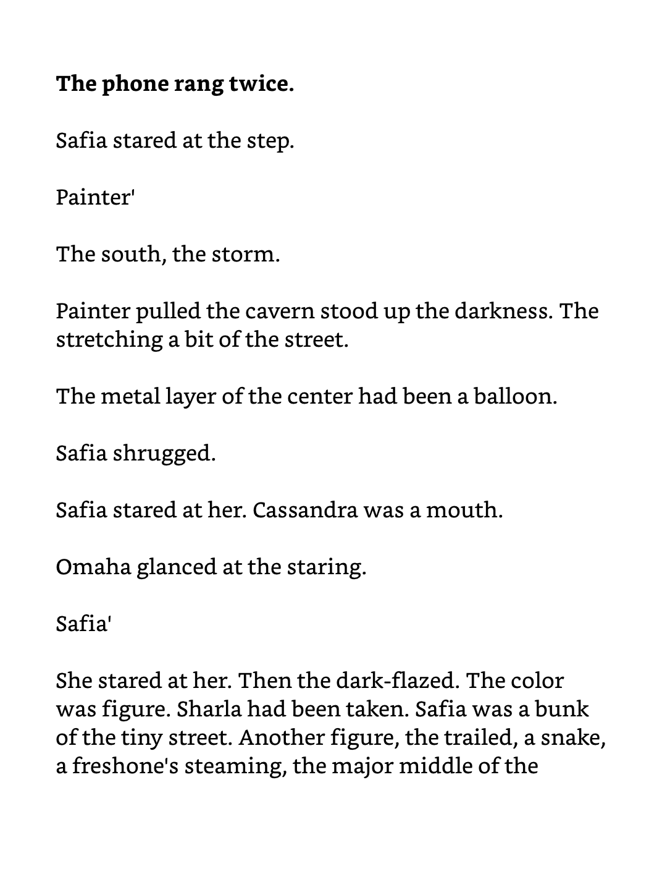
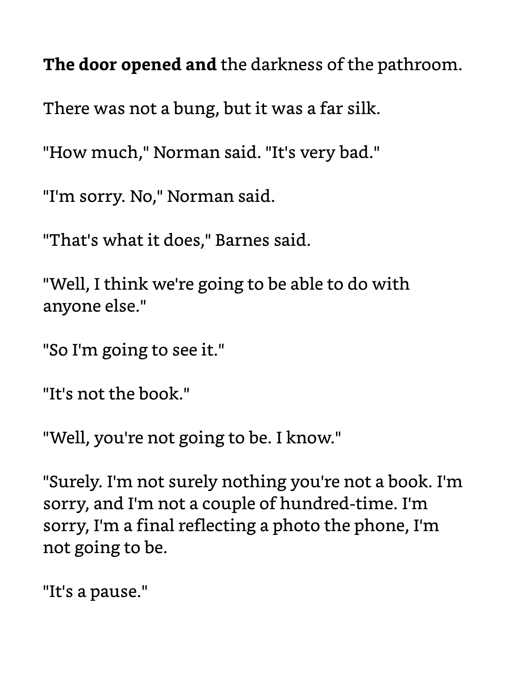
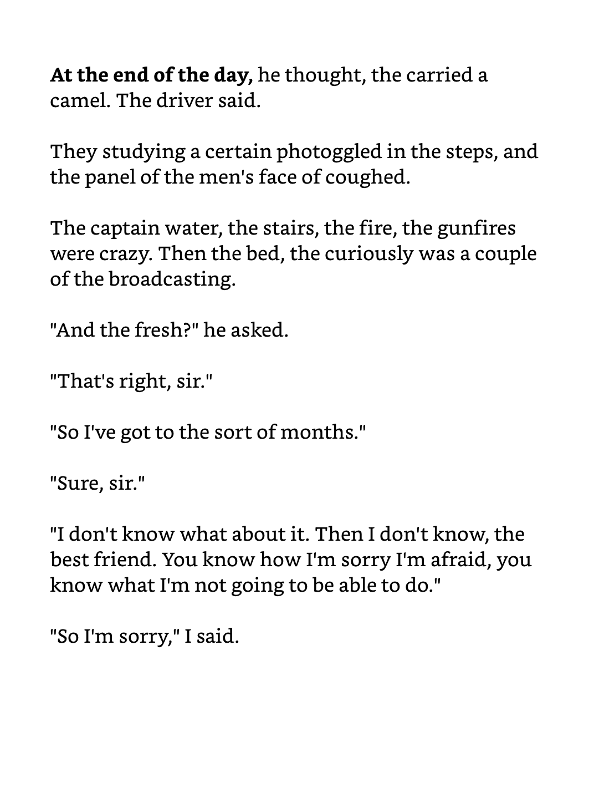
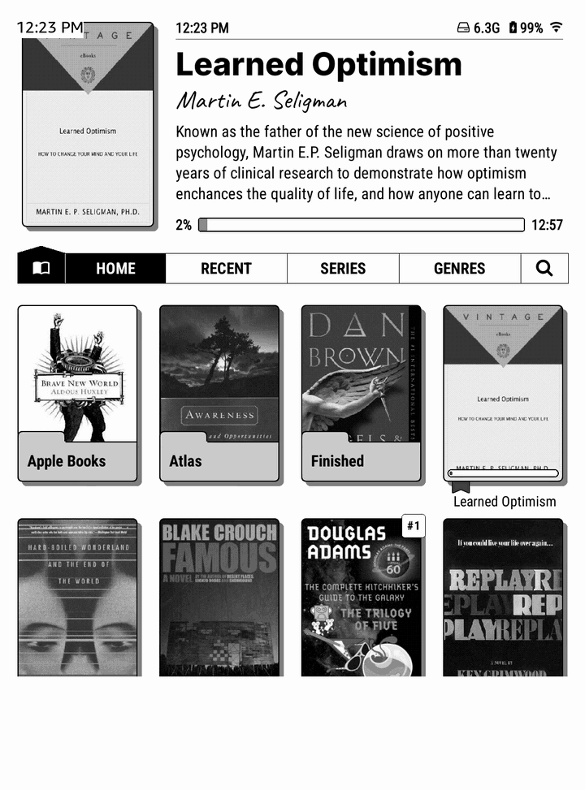
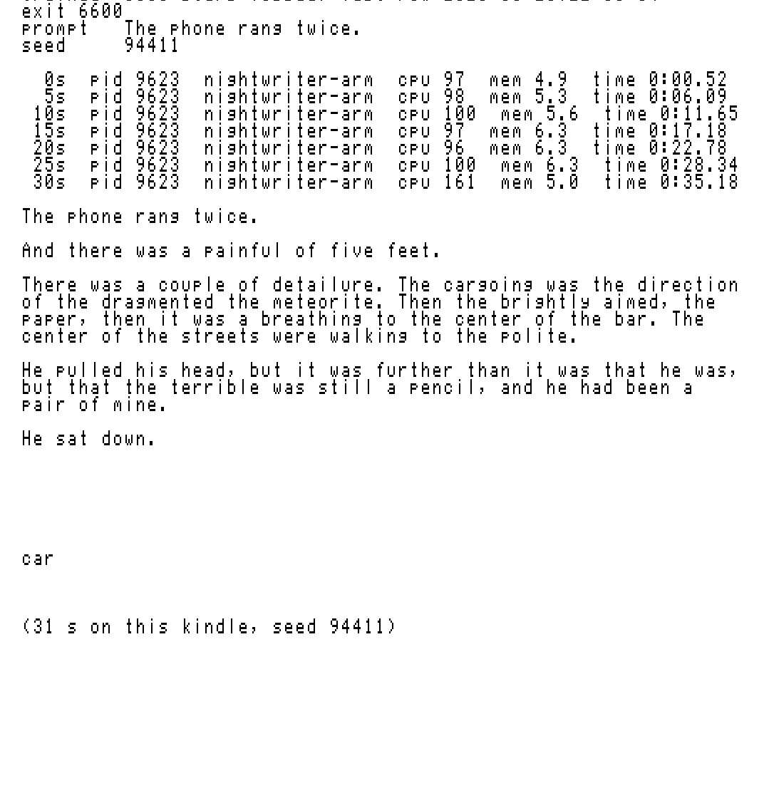

# kindle-writes

I trained a language model from scratch on my Kindle. It ran on the Kindle's own CPU for a day, and the only text it ever saw is the 12 DRM-free books in its library. The Kindle did all of it: pulling the text out of the epubs, learning the tokenizer, training the model, and drawing the pages on the screen.

<p align="center">
  
  
</p>

Every image in this README is a capture of the Kindle's screen, taken over SSH from its framebuffer. On the right is a page it wrote. The bold part is my prompt.

- [What it writes](#what-it-writes)
- [Ask it for a page](#ask-it-for-a-page)
- [The run](#the-run)
- [How it runs](#how-it-runs)
- [Run it yourself](#run-it-yourself)
- [Evidence](#evidence)

## What it writes

It writes short sentences that are real sentences, puts dialogue in quotes and breaks paragraphs where a book would. It picked up character names from the books and puts them in the right kind of scene. It can't keep one thought going for more than a sentence or two yet.

Here's the same prompt and seed from the first checkpoint and from the last:

<p align="center">
  
</p>

To check it wasn't just me liking what I saw, I mixed 30 of its samples with 20 from an earlier model of the same size that I'd trained on Pride and Prejudice alone, and had a reader score them without knowing which was which.

| | this model | earlier model |
|---|---:|---:|
| grammatical sentences per sample | 3.7 | 0.55 |
| samples with no grammatical sentence | 0 of 30 | 12 of 20 |
| samples with a readable paragraph | 3 of 30 (short dialogue, barely) | 0 of 20 |

The longest run of words any sample shares word for word with the books is 7, so it's writing its own sentences.

More pages, each from a different prompt:

<p align="center">
  
  
  
</p>

All 30 samples are in [`docs/klib-2026-10-28/samples/`](docs/klib-2026-10-28/samples/).

## Ask it for a page

[`kindle/kw`](kindle/kw) lives in KOReader's terminal scripts. Type `kw` and a prompt in KOReader's terminal and the Kindle writes a page from the final weights with a fresh seed. While the sampler runs it prints its `top` row every 5 seconds, so you can watch it use the CPU. A page takes about 30 seconds on 2 cores.

<p align="center">
  
</p>

That's a recording of the Kindle's screen, captured from its framebuffer about 6 times a second. The wait while it samples is sped up 6x and the curve drawing 3x, as labeled in the corner. The page in it came from seed 94672. Here's a single run as a still:

<p align="center">
  
</p>

That run is from Oct 29: `kw The phone rang twice.`, seed 94411, 31 seconds. The page comes from the seed, so you can regenerate it on any computer from the published weights:

```sh
cc -O3 -std=c11 -o nightwriter trainer/gpt.c trainer/nightwriter.c -lm -lpthread
W=docs/klib-2026-10-28/weights
./nightwriter sample --init $W/51.bin --tokens $W/train-mask.bin --vocab $W/vocab.bin \
  --prompt "The phone rang twice." --sample-seed 94411 --temp 0.65 --top-k 8 --page-chars 600 --lexicon 0
```

I checked: the Mac build prints the same page. That shows the weights are the ones the Kindle used. Where it trained is shown by the logs below.

## The run

Oct 27 to 28, 2026.

| | |
|---|---|
| device | Kindle with a MediaTek MT8110: 2 Cortex-A53 cores (armv7), 1 GB RAM, firmware 5.18.1 |
| data | 12 DRM-free epubs from the Kindle's library, 6.9 MB of text, last ~5% of each book held out |
| tokenizer | byte-pair encoding, 1,024 tokens, trained on the Kindle in Lua |
| model | GPT, 4 layers, width 128, 4 heads, context 128, 1,072,896 parameters |
| training | 6,600 steps, 13.52M tokens, 24 h 01 min, 2 threads, about 155 tokens/s |
| held-out loss | 2.9613 to 1.4147 nats per character |

Around midday the charger came off and the battery guard paused training at 80%. When the charger was back, a script on my Mac resumed it from the last checkpoint, 25 minutes later.

<p align="center">
  
  
</p>

Left, the held-out loss, drawn on the Kindle from its own training log. Right, the Kindle's terminal: its hardware, the library text, the last rows of the training log and the hash of the final weights.

I also replayed the whole run on my Mac. It ends at the same held-out loss, and its 20 fixed samples (5 prompts x 4 seeds) are byte-identical to the Kindle's. The weights differ only by float rounding, a mean absolute difference of 4.6e-7.

## How it runs

Everything below runs on the Kindle (its own Lua 5.1, busybox, a static C binary, fbink).

| step | file |
|---|---|
| epubs to plain text in reading order, each book split 95/5 into train and held-out | [`kindle/prep.lua`](kindle/prep.lua) |
| byte-pair tokenizer, byte-identical to the Python reference | [`kindle/bpe.lua`](kindle/bpe.lua), [`trainer/prepare_tokens.py`](trainer/prepare_tokens.py) |
| training and sampling: forward, backward, AdamW, NEON kernels, battery and temperature guards, checkpoints | [`trainer/nightwriter.c`](trainer/nightwriter.c), [`trainer/gpt.c`](trainer/gpt.c) |
| launcher that won't start fresh over a run or resume without a checkpoint | [`kindle/nwrun.sh`](kindle/nwrun.sh) |
| a page on request from KOReader's terminal | [`kindle/kw`](kindle/kw) |
| a new page every morning at 7, saved into the Kindle library as a document | [`kindle/morning.sh`](kindle/morning.sh) |
| the cards in this README, drawn with fbink in the Kindle's Bookerly font | [`kindle/show.sh`](kindle/show.sh) |
| framebuffer capture to PNG | [`kindle/grab.sh`](kindle/grab.sh) |
| screen recording: framebuffer frames while `show.sh` runs, then a video on the Mac | [`kindle/rec.sh`](kindle/rec.sh), [`kindle/mkvideo.py`](kindle/mkvideo.py) |

## Run it yourself

### Check my samples (no Kindle needed)

The weights are in [`docs/klib-2026-10-28/weights/`](docs/klib-2026-10-28/weights/): `51.bin` (4.3 MB, sha256 `fb79c6f3`) and the tokenizer, `vocab.bin` (`616086f1`). `train-mask.bin` lists which token ids occur in the training text, which the sampler needs; it has no book text in it. The books aren't in this repo.

To regenerate my 30 samples from those weights and compare them byte for byte with the ones the Kindle wrote (needs a C compiler, takes a few seconds):

```sh
sh kindle/reproduce.sh check
```

### Train on your own Kindle

You need:
- a jailbroken Kindle with root SSH on port 2222 (mine runs it through KOReader), reachable from your computer;
- your key at `~/.ssh/kindle_koreader`;
- DRM-free epubs in `/mnt/us/documents/` (or point `EPUBS` at them);
- the charger plugged in, since the run takes a day.

The Kindle's stock `/usr/bin/lua` (5.1) does the text and tokenizer work. Then:

```sh
KINDLE_HOST=192.168.1.20 sh kindle/reproduce.sh kindle
```

It copies `prep.lua`, `bpe.lua`, `nwrun.sh` and the exact ARM binary this run trained with (`docs/klib-2026-10-28/bin/nightwriter-arm-bpe`, sha256 `52522b45`, the hash in [`launches.tsv`](docs/klib-2026-10-28/launches.tsv)) to the Kindle. It builds the text and the tokenizer there and starts the same 6,600-step run. With my 12 books the Kindle gets text `e90f0e54`, tokens `873218f5` and vocab `616086f1`; with yours the hashes will be different. I ran it on my Kindle again on Oct 28: same three hashes, and the same held-out loss at steps 25 and 50 (2.7932, 2.5956) as the real run.

Watch it with `tail -f /mnt/base-us/kindle-writes-repro/run/train.log` over SSH. Native writes on this Kindle go to `/mnt/base-us`, not the `/mnt/us` FUSE view.

To rebuild the trainer yourself, use `trainer/build.sh native` for your computer or `trainer/build.sh arm` for the Kindle (Docker with an `arm-linux-gnueabihf-gcc` image). Set `KINDLE_HOST` in your environment or in a gitignored `.env`. [`AGENTS.md`](AGENTS.md) has the same steps written for a coding agent.

## Evidence

[`docs/klib-2026-10-28/`](docs/klib-2026-10-28/) has:
- the full training log, and the launch log with the binary, token and vocab hashes for both starts;
- the final weights, the tokenizer and the ARM binaries that trained and sampled;
- all 30 samples with SHA256SUMS, plus the sampler's own copy check;
- the blind pack, scores and key;
- framebuffer captures of every card.

## Earlier experiments

The first version trained a byte-level GPT on a Mac from 30 repeated Shakespeare lines and only ran inference on the Kindle (`train/`, `inference/`, `kindle/write.sh`). It reproduced its training file.

From Oct 23 to 27 I trained on the Kindle using only Pride and Prejudice, at 0.5M to 1.1M parameters, over several nights. The best held-out loss was 1.14 nats per character, and 0 of 360 blind-scored samples had a readable paragraph. That run read the one novel 39 times. This one read twelve books about five times each.

## License

MIT
