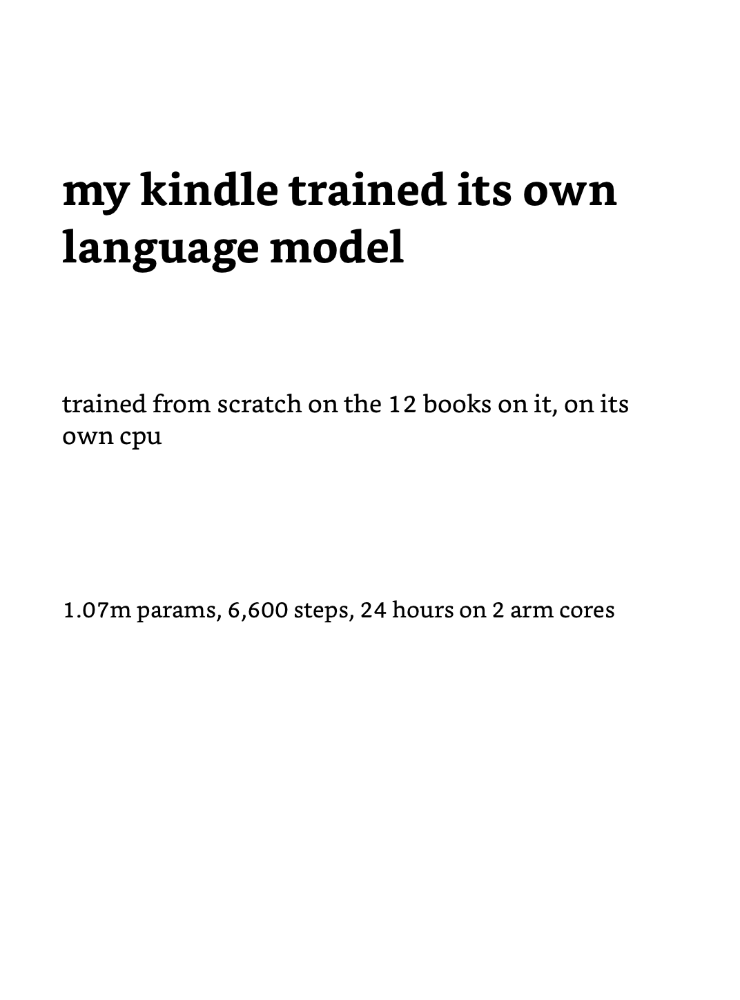
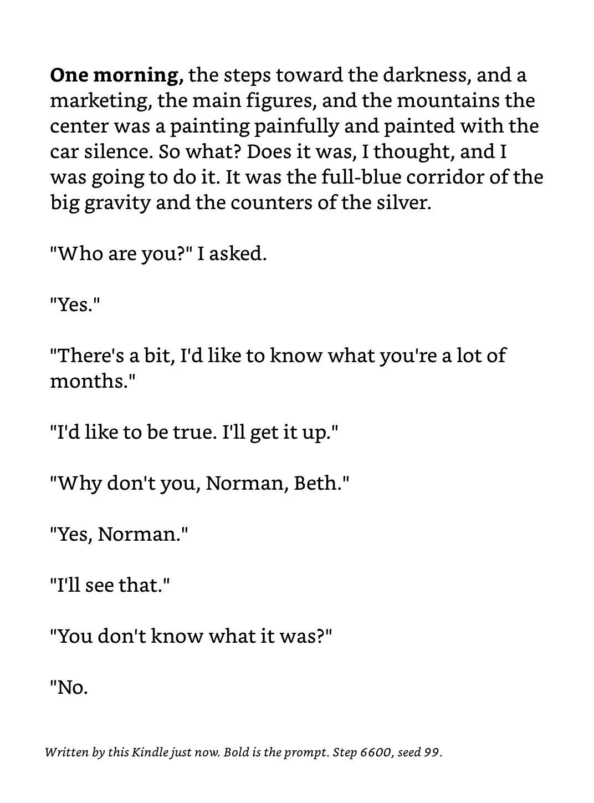
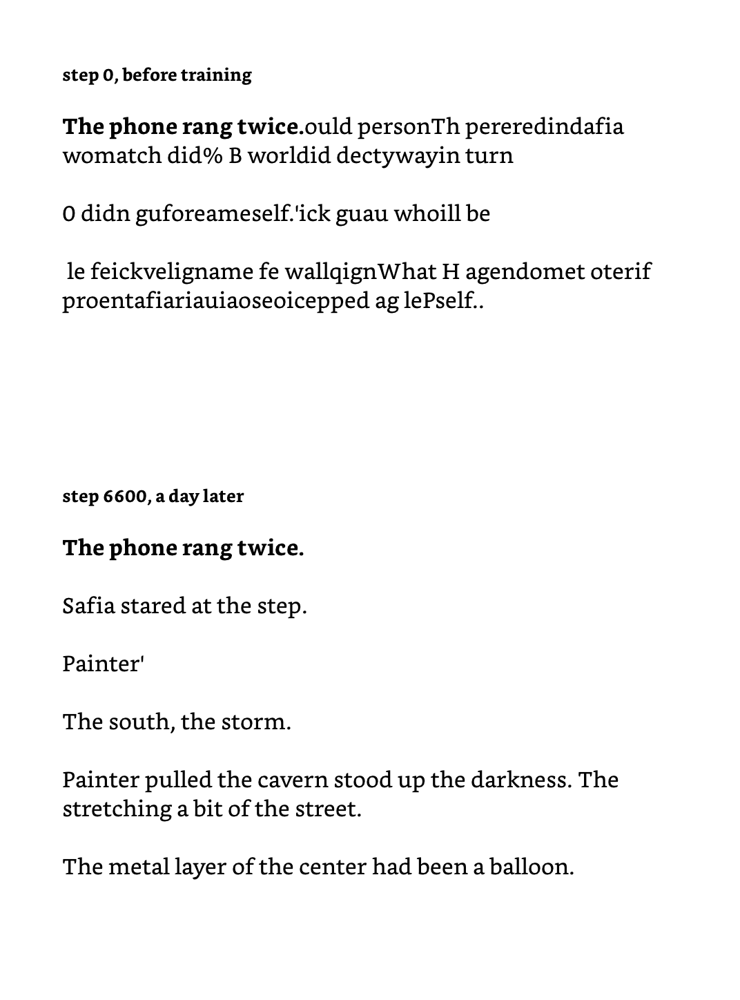
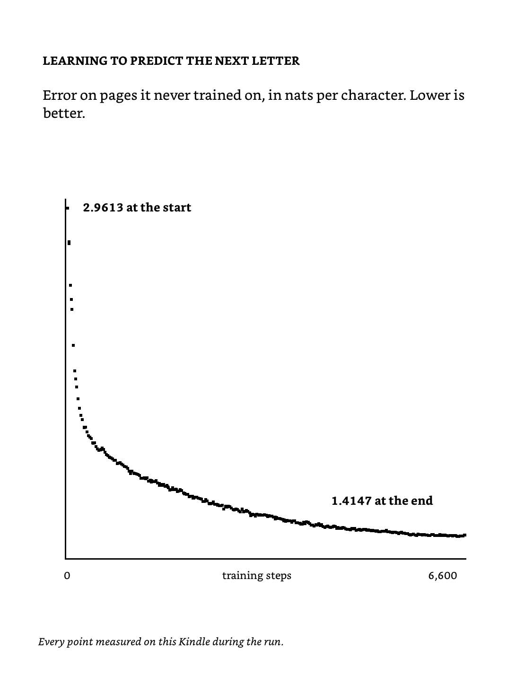
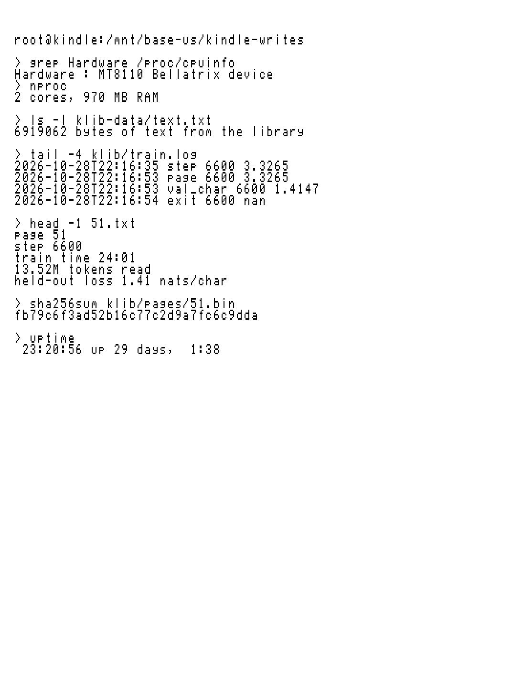

# kindle-writes

I trained a language model from scratch on my Kindle. It ran on the Kindle's own CPU for a day, and the only text it ever saw is the 12 DRM-free books in its library. The Kindle did all of it: pulling the text out of the epubs, learning the tokenizer, training the model, and drawing the pages on the screen.

<!-- PHOTO SLOT (hero): replace docs/klib-2026-10-28/photos/PHOTO-SLOT-hero.png with Abhay's photo of the Kindle, then fix this alt text. -->

This is a page it wrote. The bold part is my prompt.

## What it writes

It writes short sentences that are real sentences, puts dialogue in quotes and breaks paragraphs where a book would. It picked up character names from the books and puts them in the right kind of scene. It can't keep one thought going for more than a sentence or two yet.

Here's the same prompt and seed before training and after:

To check it wasn't just me liking what I saw, I mixed 30 of its samples with 20 from an earlier model of the same size that I'd trained on Pride and Prejudice alone, and had a reader score them without knowing which was which.

| | this model | earlier model |
|---|---:|---:|
| grammatical sentences per sample | 3.7 | 0.55 |
| samples with no grammatical sentence | 0 of 30 | 12 of 20 |
| samples with a readable paragraph | 3 of 30 (short dialogue, barely) | 0 of 20 |

The longest run of words any sample shares word for word with the books is 7, so it's writing its own sentences.

## The run

Oct 27 to 28, 2026.

| | |
|---|---|
| device | Kindle with a MediaTek MT8110: 2 Cortex-A53 cores (armv7), 1 GB RAM |
| data | 12 DRM-free epubs from the Kindle's library, 6.9 MB of text, last ~5% of each book held out |
| tokenizer | byte-pair encoding, 1,024 tokens, trained on the Kindle in Lua |
| model | GPT, 4 layers, width 128, 4 heads, context 128, 1,072,896 parameters |
| training | 6,600 steps, 13.52M tokens, 24 h 01 min, 2 threads, about 155 tokens/s |
| held-out loss | 2.9613 to 1.4147 nats per character |

Around midday the charger came off and the battery guard paused training at 80%. When the charger was back, a script on my Mac resumed it from the last checkpoint, 25 minutes later.

I also replayed the whole run on my Mac. It ends at the same held-out loss, and its 20 fixed samples (5 prompts x 4 seeds) are byte-identical to the Kindle's. The weights differ only by float rounding, a mean absolute difference of 4.6e-7.

## How it runs

Everything below runs on the Kindle (Lua 5.1, busybox, a static C binary, fbink).

| step | file |
|---|---|
| epubs to plain text in reading order, each book split 95/5 into train and held-out | [`kindle/prep.lua`](kindle/prep.lua) |
| byte-pair tokenizer, byte-identical to the Python reference | [`kindle/bpe.lua`](kindle/bpe.lua), [`trainer/prepare_tokens.py`](trainer/prepare_tokens.py) |
| training and sampling: forward, backward, AdamW, NEON kernels, battery and temperature guards, checkpoints | [`trainer/nightwriter.c`](trainer/nightwriter.c), [`trainer/gpt.c`](trainer/gpt.c) |
| launcher that won't start fresh over a run or resume without a checkpoint | [`kindle/nwrun.sh`](kindle/nwrun.sh) |
| a new page every morning at 7, saved into the Kindle library as a document | [`kindle/morning.sh`](kindle/morning.sh) |
| the cards in this README, drawn with fbink in the Kindle's Bookerly font | [`kindle/show.sh`](kindle/show.sh) |
| framebuffer capture to PNG | [`kindle/grab.sh`](kindle/grab.sh) |

Native writes on this Kindle go to `/mnt/base-us`, not the `/mnt/us` FUSE view. Build the trainer with `trainer/build.sh` (`native` for a Mac, `arm` for the Kindle via Docker). Set `KINDLE_HOST` in your environment or in a gitignored `.env`.

The books and the trained weights aren't in this repo. The weights are 4.3 MB, and their SHA256 is in [`docs/klib-2026-10-28/samples/WEIGHTS`](docs/klib-2026-10-28/samples/WEIGHTS).

## Evidence

[`docs/klib-2026-10-28/`](docs/klib-2026-10-28/) has:
- the full training log;
- all 30 samples with SHA256SUMS, plus the sampler's own copy check;
- the blind pack, scores and key;
- framebuffer captures of every card.

## Earlier experiments

The first version trained a byte-level GPT on a Mac from 30 repeated Shakespeare lines and only ran inference on the Kindle (`train/`, `inference/`, `kindle/write.sh`). It reproduced its training file.

From Oct 23 to 27 I trained on the Kindle using only Pride and Prejudice, at 0.5M to 1.1M parameters, over several nights. The best held-out loss was 1.14 nats per character, and 0 of 360 blind-scored samples had a readable paragraph. That run read the one novel 39 times. This one read twelve books about five times each, and that's what got it to sentences.

## License

MIT
